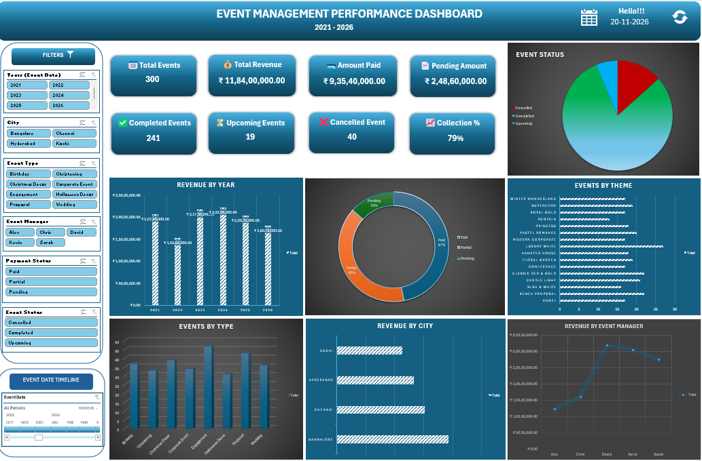

# Event Management Performance Dashboard

An interactive Excel dashboard that analyses 300 events across 4 cities from 2021 to 2026, with a focus on revenue collection and event status.

## Overview

The dashboard answers three questions for an event planning business: how much of the revenue has actually been collected, how many events were completed or cancelled, and how performance differs by year, city, event type and event manager.

Cities: Bangalore, Chennai, Hyderabad, Kochi. Period: 2021 to 2026.

## Key results

| Metric | Value |
|---|---|
| Events analysed | 300 |
| Revenue collection rate | **79%** |
| Payment status | 47% paid, 40% partial, 13% pending |
| Completed events | 241 |
| Upcoming events | 19 |
| Cancelled events | 40 (13% cancellation rate) |

## What is on the dashboard

- **8 KPI cards**
- **7 charts**: revenue by year, city and event manager; events by type and theme; event status; payment status
- **6 slicers**: year, city, event type, event manager, payment status, event status
- A **date timeline** for one-click filtering

## How it is built

- Pivot tables feed every chart and KPI
- INDEX-MATCH lookups connect data across **5 sheets**
- Slicers and the timeline are connected to all pivot tables so every visual filters together

## Tech stack

Excel: pivot tables, INDEX-MATCH, charts, slicers, timelines.

## Author

**Romy Avril Augustine**, Data Analyst, Kochi, India. 9 years of professional experience (since 2017) across finance operations and, now, analytics.
[LinkedIn](https://www.linkedin.com/in/romyavril/) | [Portfolio](https://romyavril96.github.io/Romy_Portfolio/) | avrilaugustine1996@gmail.com
